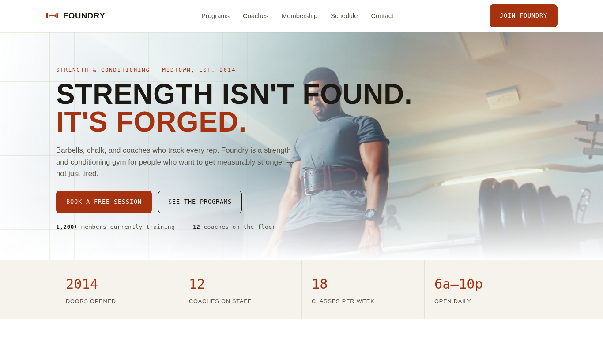

# Foundry — Gym & Fitness Website

Bold, responsive website for a strength & conditioning gym.

**Live demo:** https://ammad-codes.github.io/Gym-Fitness-Website/

## Tech used
HTML5, CSS3

## Features
- Hero with clear 'book a free session' call-to-action
- Stats strip, programs, coaches and membership sections
- Class schedule section
- Responsive on mobile, tablet and desktop

## Author
Ammad Khan — Frontend Developer (HTML, CSS, Tailwind) · https://github.com/ammad-codes
